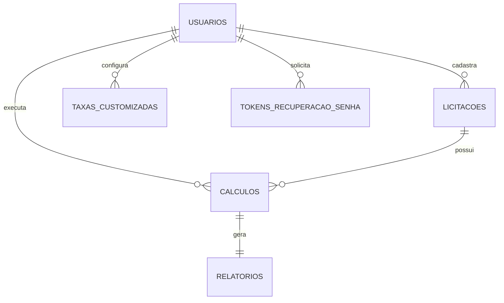
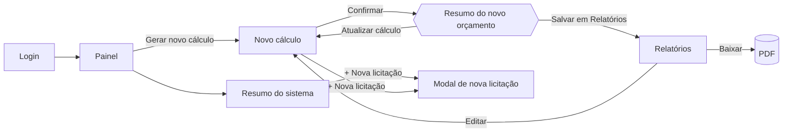

# Plano de Implementação — Calcule Certo

> **Autora:** Kate Pessoa dos Santos · **Orientador:** Prof. Juan Carlos Justiniano
> **Data:** 27/09/2026 · **Estado do código:** commit `26fad21` (Sprint 1 concluída + refatoração em camadas)
> **Período planejado:** Sprints 2 a 6, de 28/09 a 06/12/2026

---

## Sumário

1. [Resumo](#1-resumo)
2. [Fontes analisadas](#2-fontes-analisadas)
3. [Requisitos consolidados](#3-requisitos-consolidados)
4. [Lacunas e decisões pendentes](#4-lacunas-e-decisões-pendentes)
5. [Proposta do motor de cálculo](#5-proposta-do-motor-de-cálculo)
6. [Modelo de dados](#6-modelo-de-dados)
7. [API — novos endpoints](#7-api--novos-endpoints)
8. [Como os módulos novos entram na estrutura existente](#8-como-os-módulos-novos-entram-na-estrutura-existente)
9. [Plano por sprint](#9-plano-por-sprint)
10. [Estratégia de testes](#10-estratégia-de-testes)
11. [Rastreabilidade](#11-rastreabilidade)
12. [Riscos](#12-riscos)
13. [Definição de pronto](#13-definição-de-pronto)
14. [Fora do escopo](#14-fora-do-escopo)

---

## 1. Resumo

**Onde estamos.** O módulo de autenticação está pronto: cadastro, login, sessão com JWT, rotas protegidas e o código organizado em camadas (rota → controlador → serviço → repositório no back-end; página → store → serviço → cliente HTTP no front-end).

**O que falta.** O núcleo do sistema descrito no TCC: cadastro de licitações, o **motor de cálculo**, a tela de resultado, a central de relatórios com **PDF**, o painel inicial e o resumo do sistema.

**Como.** Cinco sprints quinzenais, seguindo a metodologia do TCC 2.8. O **MVP** — licitação → cálculo → relatório em PDF — fica pronto ao fim da **Sprint 4 (08/11)** e passa por uma primeira homologação com o stakeholder, como prevê o TCC 2.9. As Sprints 5 e 6 completam o sistema e fazem a homologação final. Se o prazo apertar, cortam-se funcionalidades das Sprints 5 e 6 — **a homologação, não**, porque ela produz os resultados que o TCC precisa apresentar.

**O bloqueio principal.** O TCC não define a fórmula do cálculo, e os valores do protótipo (Figura C2) não fecham matematicamente. A seção 5 propõe uma fórmula, mas ela **precisa ser validada com o stakeholder antes da Sprint 3**. As cinco perguntas da seção 4.1 devem ir para a próxima reunião quinzenal.

---

## 2. Fontes analisadas

| Fonte | O que foi aproveitado |
|---|---|
| TCC, versão corrigida (`Cópia de TCC oficial (2).pdf`, 21 p.) | Requisitos (2.1), funcionalidades (2.2), arquitetura (2.4), tecnologias (2.5), Quadro 1, processo (2.8), metas (2.9), trabalhos futuros (3) |
| TCC — Apêndice A, diagrama de classes | `Usuario`, `TaxaCustomizada`, `Calculo`, `RelatorioPDF` e seus métodos |
| TCC — Apêndice B, diagrama de caso de uso | 7 casos de uso, atores *Usuário (consultor)* e *Sistema de arquivo* |
| TCC — Apêndice C, Figuras C1, C2 e C3 | Campos do formulário, modal de resumo, central de relatórios |
| Protótipos exportados (`Desktop\CalculeCerto\`) | Painel inicial (`home-system.png`) e Resumo do sistema (`resumo-do-sistema.png`), que **não estão no TCC** |
| Protótipo de acesso (`sessão login/cadastro.png`) | Login e cadastro, já implementados na Sprint 1; landing page e login social, tratados nas seções 4.2 e 14 |
| Proposta de TCC (março/2026) | Fluxo em 5 passos: parâmetros → orçamento base → processamento → novo orçamento → PDF |
| Estudo de caso (`case-study-calcule-certo.md`) | Descrição de cada tela e três melhorias de UX sugeridas pela própria autora |
| Código atual (commit `26fad21`) | Estrutura, convenções e pendências da Sprint 1 |

A primeira cópia do TCC (`(1).pdf`) difere da segunda apenas em citações ABNT, numeração das figuras (1, 2, 3 → A1, B1, C1…) e pequenas correções de texto; nenhum conteúdo técnico muda.

---

## 3. Requisitos consolidados

### 3.1 Funcionais

| ID | Requisito | Origem |
|---|---|---|
| RF01 | Cadastrar e autenticar usuário | Classe `Usuario` — **pronto (Sprint 1)** |
| RF02 | Cadastrar licitações (número, órgão, objeto, data de abertura) | Protótipos C1, C3, Painel e Resumo — *não está no diagrama de classes* |
| RF03 | Informar o custo base: orçamento da empresa, quantidade de itens, custo fixo e custo variável | Caso de uso *Criar orçamento base*; Figura C1 |
| RF04 | Informar os parâmetros da licitação: taxa da plataforma, seguro, comissão de terceiros e margem de lucro | TCC 2.1 (input de taxas e porcentagens pelo usuário); caso de uso *Cadastrar parâmetros*; Figura C1 |
| RF05 | Salvar taxas customizadas para reutilizar | Classe `TaxaCustomizada` (`salvarTaxa()`, `atualizarTaxa()`) |
| RF06 | Calcular automaticamente custos, taxas, lucro e o novo orçamento | Casos de uso *Gerar orçamento atualizado* e *Calcular taxas variáveis*; Quadro 1 |
| RF07 | Revisar o resultado antes de salvar | Caso de uso *Revisa cálculo automático*; Figura C2 |
| RF08 | Salvar o cálculo na área de relatórios | Figura C2 |
| RF09 | Listar relatórios em ordem cronológica, agrupados por data, com filtro | Figura C3 |
| RF10 | Exportar o relatório em PDF para download | TCC 2.1; caso de uso *Exporta relatório PDF*; classe `RelatorioPDF` |
| RF11 | Editar e excluir relatórios | Figura C3 |
| RF12 | Painel inicial com licitações, relatórios recentes e alertas de prazo | Protótipo `home-system.png`; estudo de caso |
| RF13 | Resumo do sistema: tabela de licitações com status e paginação | Protótipo `resumo-do-sistema.png`; estudo de caso |
| RF14 | Atualizar o status de uma licitação | Protótipo do Resumo do sistema |
| RF15 | Perfil: editar dados e trocar a senha | Item *Perfil* do menu lateral |
| RF16 | Recuperar a senha | Link *Esqueci minha senha* do protótipo |

### 3.2 Não funcionais

| ID | Requisito | Origem |
|---|---|---|
| RNF01 | Interface responsiva para celular e computador | TCC 2.1 |
| RNF02 | Precisão absoluta nos cálculos financeiros | TCC 2.1 e 2.9; Quadro 1 |
| RNF03 | PDF compatível com os principais leitores | TCC 2.1 |
| RNF04 | Processamento centralizado no back-end | Quadro 1; TCC 2.4 |
| RNF05 | Concluir cálculo e emissão do PDF em menos de 3 minutos | TCC 2.9 (hoje leva cerca de 40 minutos) |
| RNF06 | Cada usuário só acessa os próprios dados | Derivado — o sistema guarda dados financeiros de empresas |

---

## 4. Lacunas e decisões pendentes

O plano **não para** por causa delas: cada uma tem uma proposta, e o código foi planejado para que mudar a resposta afete poucos arquivos. Ainda assim, precisam ser confirmadas.

### 4.1 Para o stakeholder — levar à próxima reunião quinzenal

Estas cinco definem a fórmula e **bloqueiam a Sprint 3**. Peça também uma **cópia da planilha que o stakeholder usa hoje**: ela será o gabarito dos testes.

| # | Pergunta | Proposta deste plano |
|---|---|---|
| Q1 | As taxas da plataforma e a comissão incidem sobre o **preço final** da proposta? | Sim. Isso muda a fórmula inteira — ver seção 5.3 |
| Q2 | A margem de lucro é um percentual **do preço final** ou **do custo**? | Do preço final |
| Q3 | O que é o campo **"Orçamento da empresa"**? | O preço que a empresa usaria hoje, sem considerar os custos da plataforma. O sistema o compara com o novo orçamento e mostra quanto a empresa ganharia ou perderia |
| Q4 | O **custo variável** é por item ou total? | Por item, multiplicado pela quantidade |
| Q5 | O **seguro da licitação** é um valor em R$ ou um percentual? | Valor em R$, somado ao custo |

### 4.2 Para o orientador

| # | Questão | Proposta deste plano |
|---|---|---|
| Q6 | O protótipo trata a **licitação** como entidade própria (número, órgão, status, prazo), mas ela não existe no diagrama de classes | Criar a classe `Licitacao` e atualizar o Apêndice A (ver seção 6.3) |
| Q7 | O diagrama de classes usa `double` para dinheiro, o que contradiz o requisito de precisão absoluta | Trocar para `decimal` no diagrama |
| Q8 | O texto da Figura C2 fala em PDF com "o histórico de todas as operações"; a Figura C3 mostra um PDF por cálculo | Um PDF por cálculo |
| Q9 | `RelatorioPDF.pathArquivo` pressupõe guardar o arquivo em disco | Gerar o PDF no momento do download, sem guardar arquivo; o registro do relatório continua existindo |
| Q10 | Login com Google e LinkedIn está no protótipo | Mover para trabalhos futuros |
| Q11 | CPF (protótipo) ou CNPJ (diagrama de classes) no cadastro | Manter CNPJ, já implementado |
| Q12 | O sistema precisa estar publicado na internet para a banca? | Apresentar localmente; publicar só se exigido (tarefa opcional na Sprint 6) |

### 4.3 Decisões de interface (da autora)

| # | Questão | Proposta deste plano |
|---|---|---|
| Q13 | Valores de status da licitação | `EDITAL_ABERTO`, `EM_ANDAMENTO`, `AGUARDANDO_APROVACAO`, `APROVADO`, `REPROVADO` — os quatro primeiros aparecem no protótipo. Atenção: no Painel, *Em andamento* e *Aguardando aprovação* aparecem **juntos** na mesma licitação; o plano assume um campo só, mas vale confirmar se são duas informações diferentes |
| Q14 | Coluna **Quantidade** do Resumo do sistema | Número de cálculos feitos para a licitação |
| Q15 | Botões **Baixar** e **Feito** da Figura C3 | *Feito* = relatório já baixado ao menos uma vez; os dois permitem baixar |
| Q16 | O que faz o lápis (editar) da Figura C3 | Abre a Figura C1 preenchida; ao salvar, cria um **novo** cálculo, preservando o histórico |
| Q17 | Onde a licitação é cadastrada (não há tela no protótipo) | Seletor no topo da Figura C1 com opção "+ Nova licitação", e botão equivalente no Resumo do sistema |

### 4.4 Observação sobre o protótipo

Os valores do modal da Figura C2 são ilustrativos e **não servem como gabarito**: o novo orçamento (R$ 1.325,00) aparece menor que os custos totais (R$ 1.350,00), e mesmo assim o lucro estimado é de R$ 1.202,90. Os testes devem usar cenários reais do stakeholder.

---

## 5. Proposta do motor de cálculo

### 5.1 Entradas

| Bloco (Figura C1) | Campo | Tipo |
|---|---|---|
| Custo base | Orçamento da empresa | R$ — opcional, não entra na fórmula (ver passo 8) |
| Custo base | Quantidade de itens | inteiro ≥ 1 |
| Custo base | Custo fixo | R$ |
| Custo base | Custo variável (por item) | R$ |
| Parâmetros da licitação | Taxa da plataforma | % |
| Parâmetros da licitação | Seguro da licitação | R$ |
| Parâmetros da licitação | Comissão de terceiros | % |
| Parâmetros da licitação | Margem de lucro | % |
| *(extensão)* | Taxas adicionais | lista de % — aceitas pelo motor e pelo banco desde a Sprint 3; a tela para incluí-las chega na Sprint 5 |

### 5.2 Fórmula proposta

Dividida nos dois métodos que a classe `Calculo` já prevê no diagrama.

> **Custos diretos e indiretos.** O texto da Figura C1 diz que o usuário *insere* os custos diretos e indiretos, mas o protótipo pede custo fixo, custo variável e quantidade. O plano segue o protótipo e **deriva** os dois valores, como mostram os passos 1 e 2. Esse mapeamento faz parte da validação com o stakeholder (Q4 e Q5).

**`processarCustos()`**

1. `custoDireto = custoVariavel × quantidadeItens`
2. `custoIndireto = custoFixo + seguro`
3. `custoTotal = custoDireto + custoIndireto`

**`aplicarTaxas()`**

4. `percentualSobrePreco = taxaPlataforma + comissaoTerceiros + Σ taxasAdicionais + margemLucro` — precisa ser menor que 100%
5. `resultadoFinal = custoTotal ÷ (1 − percentualSobrePreco ÷ 100)` — este é o **novo orçamento**
6. `valorTaxaPlataforma`, `valorComissao`, `valorTaxasAdicionais` e `lucroEstimado` = `resultadoFinal ×` o respectivo percentual
7. **Conferência:** `custoTotal + taxas + comissão + adicionais + lucro = resultadoFinal`

**Comparação com o orçamento da empresa** (se Q3 for confirmada e o campo estiver preenchido; caso contrário, a API devolve `comparacao: null`):

8. `lucroComOrcamentoAtual = orcamentoEmpresa − (taxa da plataforma, comissão e taxas adicionais calculadas sobre ele) − custoTotal`
9. `diferenca = resultadoFinal − orcamentoEmpresa`

### 5.3 Por que dividir, e não somar o percentual ao custo

As taxas da plataforma incidem **sobre o valor da operação** (TCC, Introdução), ou seja, sobre o preço final. Somar os percentuais ao custo parece certo, mas a taxa é cobrada sobre um preço maior do que o previsto — e o lucro some. Esse é justamente o tipo de erro manual que o sistema existe para evitar.

Usando a taxa máxima citada no TCC (20%) e valores redondos para o resto — custo de R$ 1.000,00, comissão de 10% e margem de 10%, que **não** vêm do TCC:

| Método | Preço proposto | Taxa + comissão | Sobra para a empresa |
|---|---|---|---|
| Somar ao custo: `1.000 × 1,40` | R$ 1.400,00 | R$ 420,00 | **prejuízo de R$ 20,00** |
| Dividir: `1.000 ÷ 0,60` | R$ 1.666,67 | R$ 500,00 | **lucro de R$ 166,67** (10% do preço) |

### 5.4 Exemplo completo

Entradas: 10 itens · custo variável R$ 80,00 · custo fixo R$ 150,00 · seguro R$ 0,00 · taxa da plataforma 5% · comissão 10% · margem 10% · orçamento da empresa R$ 1.100,00.

| Etapa | Valor | Campo no modal (Figura C2) |
|---|---|---|
| Custo direto (80 × 10) | R$ 800,00 | |
| Custo indireto | R$ 150,00 | |
| Custo total | R$ 950,00 | **Custos totais** |
| Novo orçamento (950 ÷ 0,75) | R$ 1.266,67 | **Novo orçamento gerado** |
| Taxa da plataforma (5%) | R$ 63,33 | |
| Comissão (10%) | R$ 126,67 | |
| Lucro estimado (10%) | R$ 126,67 | **Lucro estimado** |
| Taxas + comissão + lucro | R$ 316,67 | **Total taxas e margem** |
| Conferência: 950,00 + 63,33 + 126,67 + 126,67 | R$ 1.266,67 ✓ | |
| Se mantivesse R$ 1.100,00 | **prejuízo de R$ 15,00** | linha nova sugerida para o modal |

Se a empresa somasse os 25% ao custo (950 × 1,25 = R$ 1.187,50), o lucro real seria R$ 59,37 — **5% do preço, metade da margem desejada**.

O modal deve mostrar também o detalhamento acima, o que atende à melhoria que o próprio estudo de caso aponta: explicar como o lucro estimado é calculado.

### 5.5 Precisão e arredondamento (RNF02)

- **Nunca usar `number` do JavaScript para dinheiro.** `0.1 + 0.2` dá `0.30000000000000004`. O motor usa a biblioteca **decimal.js**.
- No banco, dinheiro é `NUMERIC(14,2)` e percentual é `NUMERIC(7,4)`. O driver `pg` devolve `NUMERIC` como texto, que vai direto para o `Decimal` sem passar por `number`.
- Na API, valores trafegam como **texto** (`"1266.67"`), nunca como número JSON.
- Cálculo em precisão total; arredondamento **só no fim**, para centavos, com meio para cima (`ROUND_HALF_UP`).
- Se o arredondamento das parcelas deixar diferença de centavos, ela é **absorvida pelo lucro**, para que a conferência do passo 7 feche sempre. Exemplo: custo de R$ 100,00 com 10% + 10% + 10% dá preço de R$ 142,86; as três parcelas arredondadas somariam R$ 42,87, então o lucro fica em R$ 14,28.
- O **front-end não calcula nada**: ele só formata o que o servidor devolve (RNF04).

### 5.6 Validações

| Regra | Mensagem |
|---|---|
| Valores em R$ ≥ 0 e ≤ 999.999.999.999,99 | "Informe um valor entre R$ 0,00 e …" |
| Quantidade inteira ≥ 1 | "A quantidade de itens deve ser pelo menos 1." |
| Cada percentual entre 0 e 99,9999 | "O percentual deve ser menor que 100%." |
| Soma dos percentuais sobre o preço < 100% | "A soma de taxas, comissão e margem chega a X%. Ela precisa ser menor que 100%." |
| Custo total > 0 | "Informe ao menos um custo." |
| Resultado final ≤ 999.999.999.999,99 | "O valor calculado passa do limite suportado. Revise os custos e percentuais." — o resultado pode estourar o limite mesmo com entradas válidas, porque a divisão aumenta o valor |
| Soma dos percentuais > 60% | *aviso, não bloqueia*: "Taxas e margem somam X% do preço. Confira os valores." — devolvido no campo `avisos` da resposta, para a tela exibir sem precisar calcular nada |

### 5.7 Versão da fórmula

Cada cálculo salvo grava a `versaoFormula` usada e **os resultados**, não só as entradas. Se o stakeholder pedir uma mudança na regra no meio do semestre, os relatórios antigos continuam mostrando exatamente o que foi gerado na época.

---

## 6. Modelo de dados

### 6.1 Relacionamentos



### 6.2 Tabelas novas

A tabela `usuarios` continua como está. As demais entram por **migrações** numeradas (seção 8.1).

```sql
-- 002_licitacoes.sql  (Sprint 2)
CREATE TABLE licitacoes (
  id             SERIAL PRIMARY KEY,
  usuario_id     INTEGER      NOT NULL REFERENCES usuarios(id) ON DELETE CASCADE,
  numero         VARCHAR(30)  NOT NULL,
  orgao          VARCHAR(120) NOT NULL,
  objeto         VARCHAR(255),
  status         VARCHAR(30)  NOT NULL DEFAULT 'EDITAL_ABERTO'
                 CHECK (status IN ('EDITAL_ABERTO','EM_ANDAMENTO','AGUARDANDO_APROVACAO','APROVADO','REPROVADO')),
  data_abertura  DATE,
  criado_em      TIMESTAMPTZ  NOT NULL DEFAULT NOW(),
  atualizado_em  TIMESTAMPTZ  NOT NULL DEFAULT NOW(),  -- o repositório atualiza a cada UPDATE
  UNIQUE (usuario_id, orgao, numero)
);

-- 003_calculos.sql  (Sprint 3)
CREATE TABLE calculos (
  id                      SERIAL PRIMARY KEY,
  usuario_id              INTEGER       NOT NULL REFERENCES usuarios(id) ON DELETE CASCADE,
  licitacao_id            INTEGER       NOT NULL REFERENCES licitacoes(id),
  -- entradas
  orcamento_empresa       NUMERIC(14,2)          CHECK (orcamento_empresa >= 0),  -- opcional
  quantidade_itens        INTEGER       NOT NULL CHECK (quantidade_itens > 0),
  custo_fixo              NUMERIC(14,2) NOT NULL CHECK (custo_fixo >= 0),
  custo_variavel          NUMERIC(14,2) NOT NULL CHECK (custo_variavel >= 0),
  seguro                  NUMERIC(14,2) NOT NULL DEFAULT 0 CHECK (seguro >= 0),
  taxa_plataforma         NUMERIC(7,4)  NOT NULL CHECK (taxa_plataforma >= 0 AND taxa_plataforma < 100),
  comissao_terceiros      NUMERIC(7,4)  NOT NULL CHECK (comissao_terceiros >= 0 AND comissao_terceiros < 100),
  margem_lucro            NUMERIC(7,4)  NOT NULL CHECK (margem_lucro >= 0 AND margem_lucro < 100),
  taxas_adicionais        JSONB         NOT NULL DEFAULT '[]',
  -- resultado
  custo_direto            NUMERIC(14,2) NOT NULL,
  custo_indireto          NUMERIC(14,2) NOT NULL,
  custo_total             NUMERIC(14,2) NOT NULL,
  valor_taxa_plataforma   NUMERIC(14,2) NOT NULL,
  valor_comissao          NUMERIC(14,2) NOT NULL,
  valor_taxas_adicionais  NUMERIC(14,2) NOT NULL,
  lucro_estimado          NUMERIC(14,2) NOT NULL,
  resultado_final         NUMERIC(14,2) NOT NULL,
  versao_formula          VARCHAR(10)   NOT NULL,
  criado_em               TIMESTAMPTZ   NOT NULL DEFAULT NOW()
);
CREATE INDEX calculos_usuario_data ON calculos (usuario_id, criado_em DESC);

-- 004_relatorios.sql  (Sprint 3)
CREATE TABLE relatorios (
  id          SERIAL PRIMARY KEY,
  calculo_id  INTEGER     NOT NULL UNIQUE REFERENCES calculos(id) ON DELETE CASCADE,
  gerado_em   TIMESTAMPTZ NOT NULL DEFAULT NOW(),
  baixado_em  TIMESTAMPTZ
);

-- 005_taxas_customizadas.sql  (Sprint 5)
CREATE TABLE taxas_customizadas (
  id          SERIAL PRIMARY KEY,
  usuario_id  INTEGER      NOT NULL REFERENCES usuarios(id) ON DELETE CASCADE,
  nome        VARCHAR(80)  NOT NULL,
  percentual  NUMERIC(7,4) NOT NULL CHECK (percentual >= 0 AND percentual < 100),
  tipo        VARCHAR(20)  NOT NULL CHECK (tipo IN ('PLATAFORMA','COMISSAO','ADICIONAL')),
  criado_em   TIMESTAMPTZ  NOT NULL DEFAULT NOW(),
  UNIQUE (usuario_id, nome)
);

-- 006_tokens_recuperacao_senha.sql  (Sprint 6)
CREATE TABLE tokens_recuperacao_senha (
  id          SERIAL PRIMARY KEY,
  usuario_id  INTEGER     NOT NULL REFERENCES usuarios(id) ON DELETE CASCADE,
  token_hash  CHAR(64)    NOT NULL UNIQUE,
  expira_em   TIMESTAMPTZ NOT NULL,
  usado_em    TIMESTAMPTZ
);
```

Decisões embutidas no esquema:

- **`licitacao_id` sem `ON DELETE CASCADE`**: uma licitação com cálculos não pode ser excluída, o que protege o histórico. O PostgreSQL recusa com o código `23503`, e o serviço transforma isso em resposta 409 com mensagem clara — do mesmo jeito que hoje o código `23505` vira "e-mail já cadastrado". Vale a partir da Sprint 3, quando a tabela `calculos` passa a existir.
- **`usuario_id` repetido em `calculos`**: o dono do cálculo também pode ser descoberto pela licitação, mas repetir o campo simplifica os filtros por usuário. Em troca, o serviço precisa **conferir que a licitação informada pertence ao usuário** antes de salvar; se não pertencer, responde 404.
- **Excluir um relatório exclui o cálculo**: o serviço apaga a linha de `calculos`, e o relatório sai junto pelo `ON DELETE CASCADE`. Um relatório sem cálculo não teria o que mostrar.
- **`taxas_adicionais` em JSONB**: guarda uma *cópia* das taxas usadas naquele cálculo. Se o usuário alterar uma taxa salva depois, os relatórios antigos não mudam.
- **Resultados gravados, e não recalculados**: ver seção 5.7.
- **`token_hash`**: o banco guarda apenas o hash do token de recuperação, pelo mesmo motivo que guarda só o hash da senha.

### 6.3 Alterações sugeridas no diagrama de classes (Apêndice A)

| Classe | Alteração |
|---|---|
| **`Licitacao`** *(nova)* | `id, usuarioId, numero, orgao, objeto, status, dataAbertura` · `cadastrar()`, `atualizarStatus()` · `Usuario 1 — 0..* Licitacao 1 — 0..* Calculo` |
| `Calculo` | Entradas: `+ licitacaoId`, `+ orcamentoEmpresa`, `+ quantidadeItens`, `+ custoFixo`, `+ custoVariavel`, `+ seguro`, `+ taxaPlataforma`, `+ comissaoTerceiros`, `+ taxasAdicionais` · Resultado: `+ custoTotal`, `+ valorTaxaPlataforma`, `+ valorComissao`, `+ valorTaxasAdicionais`, `+ lucroEstimado`, `+ versaoFormula` · `custoDireto` e `custoIndireto` deixam de ser digitados: são derivados por `processarCustos()` e gravados junto com o resto do resultado (seção 5.7) |
| `TaxaCustomizada` | `tipo_taxa` passa a aceitar `PLATAFORMA`, `COMISSAO` ou `ADICIONAL` |
| `RelatorioPDF` | `− pathArquivo` · `+ baixadoEm` |
| Todas | Tipos monetários de `double` para `decimal` |

---

## 7. API — novos endpoints

Todos exigem token, exceto os de recuperação de senha.

| Método | Endereço | Função | Sprint |
|---|---|---|---|
| GET | `/api/licitacoes?pagina=&status=&busca=` | Lista paginada; a quantidade de cálculos de cada uma entra na Sprint 3 | 2 |
| POST | `/api/licitacoes` | Cria licitação | 2 |
| GET | `/api/licitacoes/:id` | Detalhe | 2 |
| PUT | `/api/licitacoes/:id` | Edita número, órgão, objeto e data | 2 |
| PATCH | `/api/licitacoes/:id/status` | Muda o status | 2 |
| DELETE | `/api/licitacoes/:id` | Exclui; a partir da Sprint 3, responde 409 se houver cálculos | 2 |
| POST | `/api/calculos/simular` | Calcula **sem salvar** — alimenta o modal da Figura C2 | 3 |
| POST | `/api/calculos` | Recalcula no servidor e salva cálculo + relatório; responde 201 | 3 |
| GET | `/api/calculos/:id` | Entradas e resultado, usados pelo "editar" | 3 |
| GET | `/api/relatorios?pagina=&de=&ate=&licitacaoId=` | Lista em ordem cronológica | 4 |
| GET | `/api/relatorios/:id/pdf` | Gera e baixa o PDF; marca `baixado_em` | 4 |
| DELETE | `/api/relatorios/:id` | Exclui relatório e cálculo | 4 |
| GET | `/api/painel` | Licitações e relatórios recentes, alertas de prazo | 5 |
| GET, POST | `/api/taxas` | Lista e cria taxas salvas | 5 |
| PUT, DELETE | `/api/taxas/:id` | Edita e exclui taxa salva | 5 |
| PUT | `/api/auth/perfil` | Edita nome e CNPJ | 5 |
| PUT | `/api/auth/senha` | Troca a senha, exigindo a senha atual | 5 |
| POST | `/api/auth/esqueci-senha` | Envia o link; resposta sempre genérica | 6 |
| POST | `/api/auth/redefinir-senha` | Define nova senha com o token | 6 |

**Convenções**, mantendo o padrão atual:

- Erro: `{ "erro": "mensagem" }`, montado pelo `tratarErros`.
- Lista paginada: `{ "itens": [...], "pagina": 1, "totalPaginas": 3, "total": 25 }`.
- **Recurso de outro usuário responde 404**, e não 403, para não revelar que ele existe (RNF06). Toda consulta dos repositórios filtra por `usuario_id`.
- Valores em R$ e % trafegam como texto.

**Exemplo — `POST /api/calculos/simular`:**

```json
{
  "licitacaoId": 3,
  "orcamentoEmpresa": "1100.00",
  "quantidadeItens": 10,
  "custoFixo": "150.00",
  "custoVariavel": "80.00",
  "seguro": "0.00",
  "taxaPlataforma": "5",
  "comissaoTerceiros": "10",
  "margemLucro": "10",
  "taxasAdicionais": []
}
```

Resposta `200`:

```json
{
  "resultado": {
    "custoDireto": "800.00",
    "custoIndireto": "150.00",
    "custoTotal": "950.00",
    "valorTaxaPlataforma": "63.33",
    "valorComissao": "126.67",
    "valorTaxasAdicionais": "0.00",
    "lucroEstimado": "126.67",
    "totalTaxasEMargem": "316.67",
    "resultadoFinal": "1266.67",
    "comparacao": {
      "orcamentoEmpresa": "1100.00",
      "lucroComOrcamentoAtual": "-15.00",
      "diferenca": "166.67"
    },
    "versaoFormula": "1"
  },
  "avisos": []
}
```

Sem orçamento da empresa, `comparacao` vem `null`. Com taxas e margem acima de 60% do preço, `avisos` traz a mensagem da seção 5.6.

---

## 8. Como os módulos novos entram na estrutura existente

Nenhuma camada nova é inventada: cada módulo segue exatamente o caminho da autenticação.
Legenda: `+` arquivo novo · `~` arquivo alterado · `−` arquivo removido.

### 8.1 Back-end

```
backend/
├── package.json                    ~ scripts "migrar" e "test"; decimal.js, pdfmake, nodemailer
├── .env.example                    ~ SMTP, endereço do front e nome do banco de teste
├── src/
│   ├── app.js                      + cria o app Express (separado do listen, para os testes)
│   ├── server.js                   ~ passa a só iniciar o servidor
│   ├── db.js                       ~ + transacao(), para gravar cálculo e relatório juntos
│   ├── config/ambiente.js          ~ + SMTP e endereço do front (recuperação de senha)
│   ├── constantes/
│   │   ├── calculo.js              + limites, casas decimais, versão da fórmula
│   │   ├── licitacao.js            + STATUS_LICITACAO
│   │   ├── taxa.js                 + TIPOS_TAXA
│   │   ├── paginacao.js            + tamanho de página
│   │   └── http.js, mensagens.js, rotas.js   ~ código 23503 do PostgreSQL, novas mensagens e caminhos
│   ├── migracoes/                  + um .sql por mudança no banco, aplicados em ordem
│   │   ├── 001_usuarios.sql        + o CREATE TABLE que hoje está no setup-db
│   │   ├── 002_licitacoes.sql      + (Sprint 2)
│   │   ├── 003_calculos.sql        + (Sprint 3)
│   │   ├── 004_relatorios.sql      + (Sprint 3)
│   │   ├── 005_taxas_customizadas.sql      + (Sprint 5)
│   │   └── 006_tokens_recuperacao_senha.sql + (Sprint 6)
│   ├── repositorios/               único lugar com SQL, como hoje
│   │   ├── usuarioRepositorio.js   ~ atualizarPerfil(), atualizarSenha()
│   │   ├── licitacaoRepositorio.js +
│   │   ├── calculoRepositorio.js   +
│   │   ├── relatorioRepositorio.js +
│   │   ├── taxaRepositorio.js      +
│   │   └── tokenRecuperacaoRepositorio.js  +
│   ├── servicos/
│   │   ├── motorCalculo.js         + função pura, sem banco: processarCustos() e aplicarTaxas()
│   │   ├── calculoServico.js       + valida, chama o motor, salva em transação
│   │   ├── licitacaoServico.js     +
│   │   ├── relatorioServico.js     + listagem, filtros, exclusão, disponibilizarDownload()
│   │   ├── pdfServico.js           + gerarEstruturaPDF() com pdfmake
│   │   ├── painelServico.js        +
│   │   ├── taxaServico.js          + salvarTaxa(), atualizarTaxa()
│   │   └── autenticacaoServico.js  ~ perfil, troca e recuperação de senha
│   ├── controladores/              + um por módulo, no mesmo molde do atual
│   ├── rotas/                      + um por módulo novo, cada um com router.use(autenticar)
│   │   └── auth.js                 ~ perfil e senha protegidos rota a rota, porque login e
│   │                                 cadastro continuam públicos; esqueci/redefinir também públicos
│   ├── middleware/
│   │   └── validarId.js            + recusa :id que não seja inteiro positivo
│   ├── utils/
│   │   ├── dinheiro.js             + converter para Decimal, arredondar, formatar
│   │   ├── paginacao.js            + lê ?pagina= e monta LIMIT/OFFSET
│   │   └── email.js                + envio; em desenvolvimento, imprime o link no terminal
│   └── scripts/
│       ├── migrar.js               + aplica as migrações pendentes e registra na tabela migracoes
│       └── setup-db.js             ~ passa a só inserir os dados de demonstração
└── testes/                         + node --test, sem dependência extra
    ├── motorCalculo.test.js
    ├── validadores.test.js
    └── api/
```

Os nomes `processarCustos()`, `aplicarTaxas()`, `gerarEstruturaPDF()`, `disponibilizarDownload()`, `salvarTaxa()` e `atualizarTaxa()` são **os mesmos métodos do diagrama de classes**. Assim, a banca encontra no código cada método que está no documento.

**Por que migrações.** Hoje o `setup-db.js` cria a única tabela. Com cinco tabelas novas chegando em sprints diferentes, é preciso saber o que já foi aplicado em cada banco. A proposta mantém a decisão de escrever o SQL à mão (decisão D5 do documento de arquitetura): arquivos `.sql` numerados e um script de cerca de 30 linhas que aplica os pendentes dentro de uma transação. O `001_usuarios.sql` usa `CREATE TABLE IF NOT EXISTS`, então roda sem problema no banco que já existe.

### 8.2 Front-end

```
frontend/src/
├── App.jsx                         ~ rotas internas dentro do LayoutInterno
├── paginas/
│   ├── Home.jsx                    − tela provisória da Sprint 1 (removida na Sprint 5)
│   ├── Painel.jsx                  + substitui a Home.jsx (protótipo home-system)
│   ├── NovoCalculo.jsx             + Figura C1 + modal da Figura C2
│   ├── Relatorios.jsx              + Figura C3
│   ├── ResumoSistema.jsx           + tabela de licitações com status (protótipo)
│   ├── Perfil.jsx                  + dados, troca de senha e taxas salvas
│   ├── EsqueciSenha.jsx            +
│   └── RedefinirSenha.jsx          +
├── componentes/
│   ├── layout/
│   │   ├── LayoutInterno.jsx       + menu lateral + cabeçalho, usado por todas as telas internas
│   │   ├── MenuLateral.jsx         +
│   │   └── Cabecalho.jsx           + ajuda, sino de alertas e avatar; o campo de busca do
│   │                                 protótipo fica desativado (busca global está fora do escopo)
│   ├── Modal.jsx                   +
│   ├── CampoMoeda.jsx              + máscara R$ 1.234,56
│   ├── CampoPercentual.jsx         +
│   ├── SeletorLicitacao.jsx        + escolher ou criar licitação no topo da C1
│   ├── EtiquetaStatus.jsx          + cor e ícone de cada status
│   ├── Paginacao.jsx               +
│   └── ConfirmarExclusao.jsx       +
├── stores/
│   ├── index.jsx                   ~ registra as novas stores na RaizStore
│   ├── LicitacaoStore.js           +
│   ├── CalculoStore.js             + formulário, simulação e salvamento
│   ├── RelatorioStore.js           + lista, filtros e download
│   ├── PainelStore.js              +
│   └── TaxaStore.js                +
├── servicos/
│   ├── httpCliente.js              ~ PUT/PATCH/DELETE, download de arquivo, sessão expirada
│   └── (+ um serviço por módulo)
├── constantes/                     ~ endpoints, rotas, textos, rótulos de status, menu com rotas
├── utils/
│   ├── moeda.js                    + "1.234,56" ↔ "1234.56" e formatação em R$
│   ├── datas.js                    + agrupar em "Hoje", "Ontem", "Anteontem", data
│   └── validadores.js              ~ passa a ser usado pelos formulários
└── estilos/                        + layout.css, calculo.css, relatorios.css, painel.css
```

No documento de arquitetura, a store de cálculo foi chamada de `OrcamentoStore`. Este plano usa **`CalculoStore`** para bater com a classe `Calculo` do diagrama.

### 8.3 Telas e navegação

| Menu (protótipo) | Endereço | Tela |
|---|---|---|
| Home | `/home` | Painel |
| Orçamento | `/orcamento` | Novo cálculo (C1 + C2) |
| — | `/orcamento/:calculoId` | Novo cálculo preenchido a partir de um relatório |
| Relatórios | `/relatorios` | Central de relatórios (C3) |
| Perfil | `/perfil` | Perfil |
| Resumo do sistema | `/resumo` | Resumo do sistema |
| — | `/esqueci-senha`, `/redefinir-senha` | Recuperação (só visitantes) |



O modal de nova licitação é o mesmo componente nas duas telas: criado na Sprint 2 para o Resumo do sistema e reaproveitado na Sprint 3 pelo seletor da tela de cálculo.

### 8.4 Dependências novas

| Pacote | Onde | Motivo |
|---|---|---|
| `decimal.js` | back-end | Aritmética decimal exata (RNF02) |
| `pdfmake` | back-end | Gera PDF no servidor, com tabelas prontas e sem precisar de navegador instalado (RNF03) |
| `nodemailer` | back-end | Envio do e-mail de recuperação (Sprint 6) |

Os testes usam o executor nativo do Node (`node --test`), sem instalar nada. O front-end **não precisa de dependência nova**: a máscara de moeda e o download de arquivo ficam em `utils/`.

### 8.5 Regras que continuam valendo

- SQL só em `repositorios/`; regra de negócio só em `servicos/`; controlador não decide nada.
- Textos exibidos ao usuário ficam em `constantes/mensagens.js`, **com acento**.
- Configuração só em `config/ambiente.js`.
- Telas nunca chamam `fetch`: página → store → serviço → `httpCliente`.
- Toda tela que lê uma store é envolvida em `observer()`.
- Nomes em português.

---

## 9. Plano por sprint

> **Situação em 28/09/2026:** as Sprints 2 a 6 estão implementadas e testadas.
> Continuam abertos só os itens que dependem da empresa parceira (fórmula e
> homologação) ou do texto do TCC (diagrama de classes e resultados).

**Rotina de cada sprint** (TCC 2.8): planejamento no primeiro dia · desenvolvimento · revisão com o stakeholder na reunião quinzenal · commit e push no GitHub · cartões atualizados no Trello.

> As datas assumem início em 28/09. Ajuste ao calendário da banca: se o prazo for antes de 06/12, a prioridade é fechar o **MVP (Sprints 2–4) e homologá-lo com o stakeholder**; as funcionalidades das Sprints 5 e 6 é que cedem.

---

### Sprint 2 — Fundação e licitações · 28/09 a 11/10

**Objetivo:** preparar a base para os módulos novos, fechar as pendências da Sprint 1 e entregar o cadastro de licitações.

**Back-end**
- [x] Separar `app.js` de `server.js`
- [x] Migrações: pasta `migracoes/`, `scripts/migrar.js`, comando `npm run migrar`; mover o `CREATE TABLE usuarios` para `001_usuarios.sql`
- [x] `db.transacao()`
- [x] Testes: comando `npm test` com `node --test`; primeiros testes dos validadores existentes
- [x] Banco de teste separado (`calcule_certo_teste`), para que os testes de API não apaguem nem sujem os dados de desenvolvimento
- [x] README: primeira instalação passa a ser `npm run migrar` e depois `npm run db:setup`; nova seção **Problemas comuns** (Docker Desktop fechado, porta 3001 ocupada), os dois incidentes que já aconteceram
- [x] Colocar acento em todas as mensagens de `constantes/mensagens.js` (hoje: "Nao foi possivel", "Ja existe", "Sessao expirada"…)
- [x] Módulo de licitações completo: migração `002`, repositório, serviço, controlador, rotas, incluindo troca de status
- [x] `middleware/validarId.js` e `utils/paginacao.js`

**Front-end**
- [x] `LayoutInterno` com menu lateral e cabeçalho do protótipo; menu passa a navegar
- [x] `httpCliente`: métodos PUT/PATCH/DELETE e **sessão expirada** — resposta 401 em requisição **autenticada** encerra a sessão e volta ao login. O 401 do login com senha errada não entra nessa regra: continua sendo mostrado na tela. Para evitar importação circular (a store usa o `httpCliente`), a `SessaoStore` registra no `httpCliente` a função a chamar quando a sessão expirar
- [x] **Ligar `utils/validadores.js` aos formulários de Login e Cadastro** — corrige a afirmação do documento de Andamento, que diz que a tela valida os dados
- [x] `ResumoSistema.jsx` como lista de licitações: tabela, paginação, etiquetas de status, "+ Nova licitação" em modal, troca de status. A coluna *Quantidade* fica oculta até a Sprint 3, quando passam a existir cálculos para contar
- [x] `LicitacaoStore` e `licitacaoServico`

**Critérios de aceite**
- `npm run migrar` funciona em banco vazio e no banco atual
- Criar, editar, mudar status e excluir licitação funcionam
- Uma segunda conta não vê nem acessa as licitações da primeira (testar pela URL)
- Formulários mostram erro antes de enviar
- `npm test` passa

**Demonstração:** zerar o banco, rodar as migrações, criar duas contas e mostrar que uma não enxerga os dados da outra.

**Cartões do Trello:** Separar app e servidor · Migrações do banco · Configurar testes e banco de teste · Atualizar README · Acentuar mensagens do back-end · API de licitações · Layout interno · Sessão expirada · Validação nos formulários · Tela Resumo do sistema

---

### Sprint 3 — Motor de cálculo · 12/10 a 25/10 ★ núcleo do sistema

**Pré-requisito:** perguntas Q1 a Q5 respondidas pelo stakeholder e planilha de referência em mãos.

**Back-end**
- [x] `decimal.js`; `utils/dinheiro.js`; `constantes/calculo.js`
- [x] **`servicos/motorCalculo.js`** — função pura, com `processarCustos()` e `aplicarTaxas()`; já aceita `taxasAdicionais`, para não exigir mudança no motor e no banco na Sprint 5
- [x] **Testes do motor** (lista na seção 10.1) — escritos **antes** de ligar o motor às telas
- [x] Migrações `003_calculos` e `004_relatorios`
- [x] `calculoRepositorio`, `relatorioRepositorio.inserir()`
- [x] `calculoServico`: `simular()` sem salvar; `salvar()` confere que a licitação é do usuário, recalcula no servidor e grava cálculo + relatório em uma transação
- [x] Rotas `POST /api/calculos/simular`, `POST /api/calculos`, `GET /api/calculos/:id`
- [x] Licitações: a listagem passa a trazer a quantidade de cálculos; excluir licitação com cálculos responde 409

**Front-end**
- [x] `utils/moeda.js`, `CampoMoeda`, `CampoPercentual`
- [x] `SeletorLicitacao` no topo da tela, reaproveitando o modal de nova licitação da Sprint 2
- [x] Coluna *Quantidade* ativada no Resumo do sistema
- [x] **`NovoCalculo.jsx`** — Figura C1, com os blocos *Custo base* e *Parâmetros da licitação*
- [x] **Modal de resumo** — Figura C2, com o detalhamento do cálculo, a comparação com o orçamento da empresa e os botões *Atualizar cálculo* e *Salvar em Relatórios*
- [x] `CalculoStore`
- [x] Diferenciar visualmente valor preenchido de placeholder (melhoria apontada no estudo de caso)

**Critérios de aceite**
- O exemplo da seção 5.4 aparece na tela **centavo por centavo**
- Pelo menos **3 cenários reais** do stakeholder batem com a planilha dele
- Soma de percentuais ≥ 100% é bloqueada com mensagem clara
- Alterar o resultado no navegador (pelo DevTools) não altera o que é salvo, porque o servidor recalcula

**Demonstração:** preencher a C1, abrir o resumo, voltar e ajustar, salvar. Mostrar o teste do motor rodando no terminal.

**Cartões do Trello:** Validar fórmula com stakeholder · Motor de cálculo · Testes do motor · Tabelas de cálculo e relatório · API de simulação e salvamento · Campos de moeda e percentual · Tela Novo cálculo · Modal de resumo

---

### Sprint 4 — Relatórios e PDF · 26/10 a 08/11 🎯 fecha o MVP

**Back-end**
- [x] `pdfmake`; **prova de conceito do PDF no primeiro dia**. No servidor, o pdfmake exige declarar os arquivos de fonte; a prova de conceito deve confirmar que `ç`, `ã` e `é` saem corretos
- [x] `pdfServico.gerarEstruturaPDF()`: cabeçalho com o nome do sistema e o nome e CNPJ do usuário, dados da licitação, entradas, detalhamento do resultado, comparação, data de geração e rodapé com numeração. *(O cadastro não tem campo de razão social; se o stakeholder quiser o nome da empresa no PDF, ele entra no Perfil, na Sprint 5.)*
- [x] `GET /api/relatorios` com filtros por período e licitação, paginação e ordem cronológica decrescente
- [x] `GET /api/relatorios/:id/pdf`: `Content-Type: application/pdf`, `Content-Disposition: attachment` com nome legível (ex.: `calculo-licitacao-1101-2026-10-30.pdf`); marca `baixado_em`
- [x] `DELETE /api/relatorios/:id`

**Front-end**
- [x] **`Relatorios.jsx`** — Figura C3: grupos *Hoje*, *Ontem*, *Anteontem* e data; filtro; botões *Baixar* e *Feito*; editar abre a C1 preenchida; excluir com confirmação
- [x] `httpCliente.baixarArquivo()` e `utils/datas.js`
- [x] `RelatorioStore`

**Critérios de aceite**
- O PDF abre sem erro no Adobe Reader, no Edge, no Chrome e no celular (RNF03)
- Os acentos aparecem corretamente no PDF
- Os valores do PDF são idênticos aos da tela
- Editar gera um novo cálculo; o antigo continua no histórico
- **Cronometrar o fluxo completo** — login, novo cálculo, salvar, baixar PDF — como primeira medição da meta de 3 minutos

**Demonstração:** o fluxo inteiro do MVP, de ponta a ponta.

**Primeira homologação:** na reunião de fim de sprint, o stakeholder usa o MVP com seus próprios cenários (TCC 2.9: o MVP é "o principal instrumento de avaliação prática"). O que ele apontar entra no planejamento da Sprint 5.

**Cartões do Trello:** Prova de conceito do PDF · Geração do PDF · API de relatórios · Tela de relatórios · Download · Editar e excluir relatório · Teste do PDF em vários leitores · Homologação do MVP

---

### Sprint 5 — Painel, taxas salvas e perfil · 09/11 a 22/11

**Back-end**
- [x] `GET /api/painel`: 3 licitações mais recentes, relatórios recentes e alertas (licitações com abertura nos próximos 7 dias, sem contar as já aprovadas ou reprovadas)
- [x] Migração `005_taxas_customizadas`; CRUD `/api/taxas`
- [x] `PUT /api/auth/perfil` e `PUT /api/auth/senha`

**Front-end**
- [x] **`Painel.jsx`** no lugar da Home provisória: saudação, *Minhas licitações*, *Relatórios recentes* em **um único bloco** (corrige a duplicação apontada no estudo de caso), *Alertas e prazos*, botão *Gerar novo cálculo de licitação*
- [x] Sino do cabeçalho com a contagem de alertas
- [x] **`Perfil.jsx`**: dados, troca de senha e lista de taxas salvas
- [x] Na C1: "Usar taxa salva" preenche o campo; "+ Adicionar taxa" inclui taxas adicionais (o motor e o banco já as aceitam desde a Sprint 3)
- [x] Revisão de responsividade de todas as telas internas em 375 px (RNF01)

**Critérios de aceite:** o painel reflete os dados reais; uma taxa salva pode ser aplicada em um cálculo novo; alterar essa taxa depois não muda relatórios antigos.

**Cartões do Trello:** API do painel · Tela do painel · Alertas de prazo · Taxas customizadas · Taxas na tela de cálculo · Perfil e troca de senha · Revisão mobile

---

### Sprint 6 — Recuperação de senha, segurança e homologação · 23/11 a 06/12

**Back-end**
- [x] Migração `006`; `esqueci-senha` e `redefinir-senha` com token de uso único, validade de 30 minutos e resposta sempre genérica; em desenvolvimento, o link aparece no terminal
- [x] Atualizar dependências e zerar os alertas do `npm audit` (hoje: 3 moderados no back-end, 2 no front-end)
- [x] Segredo do JWT longo e aleatório fora do ambiente de desenvolvimento

**Front-end**
- [x] `EsqueciSenha.jsx` e `RedefinirSenha.jsx`; ativar o link da tela de login

**Homologação final** (TCC 2.9) — roteiro pronto em [HOMOLOGACAO.md](HOMOLOGACAO.md)
- [ ] Sessão com o stakeholder usando cenários reais; comparar com a planilha centavo a centavo
- [ ] Cronometrar a tarefa completa — meta: menos de 3 minutos
- [ ] Registrar o feedback de usabilidade e fazer os ajustes

**Documentação**
- [x] Atualizar o README
- [ ] Atualizar o documento de arquitetura (PDF) e o diagrama de classes do TCC (seção 6.3)
- [ ] Registrar os resultados da homologação para a seção de resultados do TCC
- [ ] *(Se exigido pela banca)* publicar em um serviço com Node.js e PostgreSQL

**Cartões do Trello:** Recuperação de senha · Atualizar dependências · Homologação com stakeholder · Ajustes pós-homologação · Atualizar documentação · Atualizar diagrama de classes

---

## 10. Estratégia de testes

### 10.1 Motor de cálculo — obrigatórios

É a parte mais crítica: um erro aqui é exatamente o prejuízo que o sistema promete evitar.

1. Exemplo da seção 5.4 — resultado exato
2. Exemplo da seção 5.3 — custo R$ 1.000,00; 20% + 10% + 10% → R$ 1.666,67
3. Todos os percentuais zerados → novo orçamento igual ao custo total
4. Soma dos percentuais igual a 100% → erro
5. Soma dos percentuais acima de 100% → erro
6. Quantidade zero ou negativa → erro
7. Resíduo de arredondamento — custo R$ 100,00 com 10% + 10% + 10% → preço R$ 142,86 e lucro R$ 14,28, com a conferência fechando (seção 5.5)
8. Valores na casa dos milhões → sem perda de precisão
9. Resultado acima de R$ 999.999.999.999,99 → erro, mesmo com entradas válidas
10. Taxas adicionais entram na soma dos percentuais e no novo orçamento
11. Sem orçamento da empresa → `comparacao` nula; com R$ 1.100,00 no exemplo da seção 5.4 → prejuízo de R$ 15,00
12. Mesma entrada, mesmo resultado, sempre
13. Os 3 ou mais cenários reais da planilha do stakeholder

### 10.2 Serviços e API

Rodam contra o banco de teste separado (Sprint 2), nunca contra o de desenvolvimento.

- Validações de cada serviço (dados inválidos geram o erro e o status HTTP certos)
- **Isolamento entre usuários**: acessar recurso de outra conta responde 404 — um teste por módulo
- Salvar um cálculo informando a licitação de outro usuário responde 404
- Excluir licitação com cálculos responde 409 (a partir da Sprint 3)

### 10.3 Manual, a cada sprint

- Cada tela no navegador, em desktop e em 375 px
- Sessão expirada no meio do uso volta para o login
- PDF aberto em mais de um leitor (Sprint 4 em diante)

---

## 11. Rastreabilidade

| Requisito | Caso de uso / Figura | Sprint | Arquivos principais |
|---|---|---|---|
| RF01 Cadastro e login | classe `Usuario` | 1 ✓ | `autenticacaoServico.js`, `Login.jsx`, `Cadastro.jsx` |
| RF02 Licitações | C1, C3, Painel, Resumo | 2 | `licitacaoServico.js`, `ResumoSistema.jsx` |
| RF03 Custo base | *Criar orçamento base* · C1 | 3 | `NovoCalculo.jsx`, `calculoServico.js` |
| RF04 Parâmetros | *Cadastrar parâmetros* · C1 | 3 | `NovoCalculo.jsx` |
| RF05 Taxas customizadas | classe `TaxaCustomizada` | 5 | `taxaServico.js`, `Perfil.jsx` |
| RF06 Cálculo automático | *Gerar orçamento atualizado* · *Calcular taxas variáveis* | 3 | `motorCalculo.js` |
| RF07 Revisar antes de salvar | *Revisa cálculo automático* · C2 | 3 | `NovoCalculo.jsx` (modal) |
| RF08 Salvar em relatórios | C2 | 3 | `calculoServico.salvar()` |
| RF09 Histórico com filtro | C3 | 4 | `relatorioServico.js`, `Relatorios.jsx` |
| RF10 PDF | *Exporta relatório PDF* · classe `RelatorioPDF` | 4 | `pdfServico.js` |
| RF11 Editar e excluir | C3 | 4 | `Relatorios.jsx` |
| RF12 Painel | protótipo `home-system` | 5 | `painelServico.js`, `Painel.jsx` |
| RF13 Resumo do sistema | protótipo `resumo-do-sistema` | 2 | `ResumoSistema.jsx` |
| RF14 Status da licitação | protótipo `resumo-do-sistema` | 2 | `licitacaoServico.js` |
| RF15 Perfil | menu lateral | 5 | `Perfil.jsx` |
| RF16 Recuperar senha | protótipo de login | 6 | `EsqueciSenha.jsx`, `RedefinirSenha.jsx` |
| RNF01 Responsivo | TCC 2.1 | todas | `estilos/` |
| RNF02 Precisão | TCC 2.1 · Quadro 1 | 3 | `utils/dinheiro.js`, `testes/` |
| RNF03 PDF compatível | TCC 2.1 | 4 | `pdfServico.js` |
| RNF04 Cálculo no servidor | Quadro 1 | 3 | `motorCalculo.js` |
| RNF05 Menos de 3 minutos | TCC 2.9 | 4 e 6 | medição na homologação |
| RNF06 Isolamento de dados | derivado | 2 em diante | todos os repositórios |

---

## 12. Riscos

| Risco | Probabilidade | Impacto | Mitigação |
|---|---|---|---|
| Fórmula não validada a tempo | média | **alto** | Levar a seção 5 à próxima reunião. O motor é uma função isolada: trocar a regra não afeta telas, banco nem API |
| Erros de arredondamento | média | **alto** | `decimal.js`, `NUMERIC` no banco, valores como texto na API, testes com a planilha do stakeholder |
| Prazo do TCC | alta | **alto** | MVP fechado e homologado na Sprint 4; se faltar tempo, cortam-se funcionalidades das Sprints 5 e 6, mas a homologação final é mantida |
| Escopo crescer (landing page, login social, busca) | média | médio | Itens declarados fora do escopo (seção 14) |
| Biblioteca de PDF não atender | baixa | médio | Prova de conceito no primeiro dia da Sprint 4 |
| Ambiente — Docker fechado, porta ocupada | média | baixo | Já aconteceu duas vezes; seção *Problemas comuns* no README (Sprint 2) |
| Banca questionar a classe `Licitacao` fora do diagrama | média | médio | Atualizar o Apêndice A (seção 6.3) antes da defesa |

---

## 13. Definição de pronto

Uma tarefa só vai para *Concluído* no Trello quando:

- [ ] Segue as camadas: SQL só no repositório, regra só no serviço, textos em `constantes/`
- [ ] Toda consulta filtra pelo usuário logado
- [ ] `npm test` passa
- [ ] Foi testada no navegador, em desktop e em 375 px
- [ ] Mensagens de erro estão em português, com acento
- [ ] O README foi atualizado, se algum comando ou configuração mudou
- [ ] Tem commit com mensagem descritiva e push no GitHub

---

## 14. Fora do escopo

Declarados como **trabalhos futuros**, para proteger o prazo:

- Leitura automática de editais em PDF com inteligência artificial *(TCC, Conclusão)*
- Histórico de lances *(TCC, Conclusão)*
- Login com Google e LinkedIn
- ~~Landing page pública~~ — **feita em 30/09/2026** (tela inicial em `/`)
- Busca global no cabeçalho
- Notificações por e-mail de prazos
- Vários usuários por empresa, com permissões
- Sessão com cookie `httpOnly` e renovação de token *(melhoria de segurança já registrada no documento de arquitetura)*
